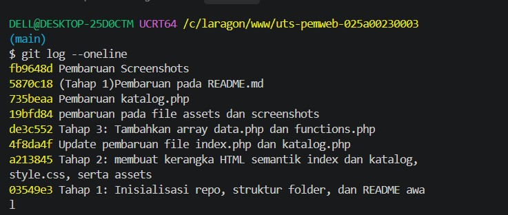

# README - Kopi & Senja Kafe

## 1. Identitas

- **Nama:** Sabilla Istiqomah
- **NIM:** 025A00230003
- **Kelas:** [Isi kelas]
- **Program Studi:** Informatika
- **Mata Kuliah:** Pemrograman Web

## 2. Deskripsi Project

Kafe Senja merupakan website sederhana berbasis PHP yang menampilkan informasi dan katalog menu kafe. Project ini dibuat untuk menerapkan dasar pemrograman PHP, pengelolaan data menu, serta penggunaan fungsi untuk membantu menampilkan dan mengolah data.

Website ini menyajikan profil resmi kafe serta katalog menu yang dikelompokkan ke dalam lima kategori, yaitu Makanan, Snack, Dessert, Minuman Kopi, dan Minuman Non Kopi. Selain itu, website dilengkapi dengan fitur filter interaktif berdasarkan kategori serta perhitungan statistik ringkasan harga secara dinamis.

## 3. Cara Menjalankan Project di Localhost

Ikuti langkah-langkah berikut untuk menjalankan proyek pada server lokal:

### 1. Persiapan Web Server PHP

Pastikan sudah memasang lingkungan server lokal seperti Laragon atau XAMPP, atau menggunakan PHP CLI Built-in Server. Gunakan PHP versi 8.1 atau lebih baru.

### 2. Mengunduh Proyek

Unduh repositori proyek melalui GitHub dengan menuju ke tombol Code di kanan atas repositori lalu memilih Download ZIP atau menggunakan perintah Git melalui terminal:

git clone https://github.com/sabilla/uts-pemweb-025a00230003.git

### 3. Memindahkan Folder Proyek

Ekstrak atau tempatkan folder proyek ke dalam direktori root server lokal sesuai aplikasi yang digunakan:

Laragon: C:/laragon/www/uts-pemweb-025a00230003

XAMPP: C:/xampp/htdocs/uts-pemweb-025a00230003

### 4. Menjalankan Web Server

Buka Laragon atau XAMPP, kemudian jalankan layanan web server (Apache). Pastikan status server sudah aktif (running) sebelum melanjutkan.

### 5. Membuka Proyek Melalui Browser

Buka peramban web (browser), kemudian akses alamat berikut:

http://localhost/uts-pemweb-025a00230003/index.php

### 6. Memeriksa Halaman Website

Setelah halaman utama berhasil dibuka, navigasikan website melalui menu navigasi yang tersedia untuk memeriksa fitur dan halaman berikut:

- Profil (index.php): Menampilkan informasi utama profil kafe, jam operasional, lokasi, dan deskripsi Kafe Senja.

- Katalog Menu (katalog.php): Menampilkan daftar menu kuliner interaktif dilengkapi tombol filter kategori, status ketersediaan (Tersedia/Kosong), dan statistik ringkasan harga secara dinamis.

## 4. Daftar Fitur, File, dan Fungsi yang Digunakan

### 4.1 Halaman Profil dan Navigasi Antarhalaman

- **File:** `index.php`, `style.css`
- **Fungsi:** Menampilkan informasi profil kafe, jam operasional, lokasi, serta menu navigasi antarhalaman.
- **Implementasi:** Menggunakan elemen HTML5 semantik seperti `<header>`, `<nav>`, `<main>`, `<section>`, dan `<footer>` untuk menyusun struktur halaman website.

### 4.2 Katalog Menu Interaktif dan Filter Kategori

- **File:** `katalog.php`
- **Fungsi:** Menampilkan daftar menu berdasarkan kategori yang dipilih pengguna.
- **Implementasi:** Mengambil kategori yang dipilih melalui `$_GET['kategori']`, menyaring data menu, menggunakan perulangan `foreach`, serta menampilkan kartu menu secara dinamis.

### 4.3 Ringkasan Hasil Perhitungan

- **File:** `functions.php`, `katalog.php`
- **Fungsi:** Menghitung jumlah menu yang ditampilkan dan rata-rata harga menu.
- **Implementasi:** Menggunakan fungsi buatan `formatRupiah()` untuk memformat harga ke dalam bentuk rupiah dan `hitungRataHarga()` untuk menghitung rata-rata harga menu.

### 4.4 Keamanan Output Data

- **File:** `functions.php`
- **Fungsi:** Membantu menjaga keamanan data yang ditampilkan pada halaman website.
- **Implementasi:** Menggunakan fungsi pembungkus `e()` yang menerapkan fungsi bawaan PHP `htmlspecialchars()` untuk membantu mencegah serangan Cross-Site Scripting (XSS).

## 5. Daftar Fungsi Array Bawaan PHP dan Kegunaannya

Berikut fungsi array bawaan PHP yang digunakan dalam project Kopi & Senja Kafe:

| No. | Fungsi Array | Kegunaan |
|---|---|---|
| 1 | `count()` | Menghitung jumlah elemen dalam array, termasuk jumlah total menu yang tersedia atau sedang ditampilkan. |
| 2 | `array_filter()` | Menyaring daftar menu berdasarkan kategori yang dipilih oleh pengguna. |
| 3 | `array_column()` | Mengambil nilai dari kolom tertentu, seperti kolom harga pada array multidimensi. |
| 4 | `array_sum()` | Menjumlahkan seluruh nilai harga menu untuk membantu menghitung rata-rata harga. |
| 5 | `array_values()` | Menyusun ulang indeks array agar dimulai kembali dari indeks numerik secara berurutan setelah proses penyaringan data. |

## 6. Tangkapan Layar

Berikut merupakan tangkapan layar hasil implementasi website Kopi & Senja Kafe.

### 6.1 Tampilan Halaman Profil

### 6.2 Tampilan Halaman Katalog Menu

### 6.3 Screenshots comiid

## 7. Sumber Referensi dan Catatan Penggunaan AI

### 7.1 Sumber Referensi & Aset

- Materi Kuliah: Modul dan acuan praktikum Tugas Pertemuan 7 Pemrograman Web (Katalog UMKM & Pemisahan Modular PHP).

- Inspirasi Menu Kafe: Struktur menu dan penamaan varian terinspirasi dari menu kafe modern (seperti Kopi Kenangan / Kopken dan kafe lokal).

- Aset Gambar: Foto suasana kafe dan produk menu diunduh dari platform Pinterest untuk kebutuhan visualisasi antarmuka.

### 7.2 Catatan Penggunaan AI

AI digunakan sebagai alat bantu untuk memahami konsep PHP, membantu memeriksa kesalahan kode.hasil akhir project tetap diperiksa dan disesuaikan kembali.

